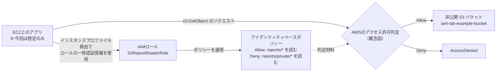

# IAM権限評価ラボ — S3の読み取り権限を設計・検証する

> 学習日: 2026-10-29  
> 目的: IAMロール・アイデンティティベースポリシー・明示的Deny・暗黙的Denyの違いを、自分で説明できるようにする。  
> スコープ: **構成図とIAM Policy Simulatorによる机上検証**。EC2やS3の実リソース作成は不要。
> まだ記載途中

## 1. 想定要件

EC2上のアプリが非公開S3バケットのレポートを読み取る。

- `reports/` 以下のオブジェクト読み取りを許可する
- `reports/private/` 以下は読み取りを禁止する
- オブジェクトの書き込みは禁止する
- 最小権限を守り、長期アクセスキーをアプリに保存しない

## 2. 構成図



**注**: AWSがリクエスト時に関連ポリシーを評価する仕組みを学ぶための概念図。実際にAWS認可判定用の専用サーバーを別途用意するわけではない。今回はS3バケットポリシーを設定しない想定。実際の権限評価には、構成によってバケットポリシー、SCP、Permissions boundary、セッションポリシーなども関わる。

## 3. IAMポリシー（検証用サンプル）

`iam-lab-example-bucket` は架空のバケット名。必要に応じて自分の名前に置き換える。

```json
{
  "Version": "2012-10-17",
  "Statement": [
    {
      "Sid": "AllowReadReports",
      "Effect": "Allow",
      "Action": "s3:GetObject",
      "Resource": "arn:aws:s3:::iam-lab-example-bucket/reports/*"
    },
    {
      "Sid": "DenyReadPrivateReports",
      "Effect": "Deny",
      "Action": "s3:GetObject",
      "Resource": "arn:aws:s3:::iam-lab-example-bucket/reports/private/*"
    }
  ]
}
```

## 4. 予想 → シミュレーション → 記録

まず「予想」列を自力で記入する。その後、AWS IAMコンソールの **Policy simulator** で対象のアクション、リソースARNを指定して検証する。

| ケース | Action | Resource（共通接頭辞 `arn:aws:s3:::iam-lab-example-bucket/`） | 予想 | 実際の判定と根拠 |
|---|---|---|---|---|
| A | `s3:GetObject` | `reports/weekly.csv` | `許可される` | |
| B | `s3:GetObject` | `reports/private/payroll.csv` | `拒否される` | |
| C | `s3:PutObject` | `reports/weekly.csv` | `拒否される` | |

※ シミュレーターは実際のS3 APIリクエストを送らず、ポリシーの許可判定を模擬する。実システムでの最終確認は別途必要。

## 5. 説明できるようにしたいこと

- [ ] IAMロールとIAMユーザーの違いを説明できる
IAMユーザは、特定の利用者に紐づくIDで、長期的な認証情報を持つ。
IAMロールは、許可された利用者やAWSサービスが引き受けることで、一時的な認証情報を利用できる。例えば、EC2からS3にアクセスする場合は、アクセスキーをEC2に保存するのではなく、必要なS3アクセス権限を持つIAMロールを割り当てる。

- [ ] `Action` / `Resource` / `Effect` の意味を説明できる
Effectは実行を許可するか拒否するかを記載する。
ActionはAWSのアクション内容を記載する。
ResourceはどのAWSリソースに関し、アクションを行うか記載する。

- [ ] `Allow` と **明示的Deny** と **暗黙的Deny** を区別できる
明示的Deny：禁止すると明記されている
暗黙的Deny：許可されていないので、原則として拒否される

- [ ] S3のバケットARNとオブジェクトARNの違いを説明できる
- [ ] なぜ `s3:*` / `Resource: "*"` を避けるのか説明できる
- [ ] 構成図を見ずに1分で設計意図を説明できる

## 6. ふりかえり（自分の言葉で書く）

### なぜIAMユーザーのアクセスキーではなくロールを使う？

（ここに記入）

### 明示的Denyと暗黙的Denyはどう違う？

（ここに記入）

### この構成を本番運用するなら何を追加で検討する？

（例: S3バケットポリシー、CloudTrail、アクセス経路、SSE-KMS、ロール権限の絞り込み）

（ここに記入）

## 7. 公式ドキュメント

- [AWS IAM ポリシーの評価論理](https://docs.aws.amazon.com/ja_jp/IAM/latest/UserGuide/reference_policies_evaluation-logic.html)
- [IAM Policy Simulator](https://docs.aws.amazon.com/IAM/latest/UserGuide/access_policies_testing-policies.html)
- [IAMロール](https://docs.aws.amazon.com/ja_jp/IAM/latest/UserGuide/id_roles.html)
